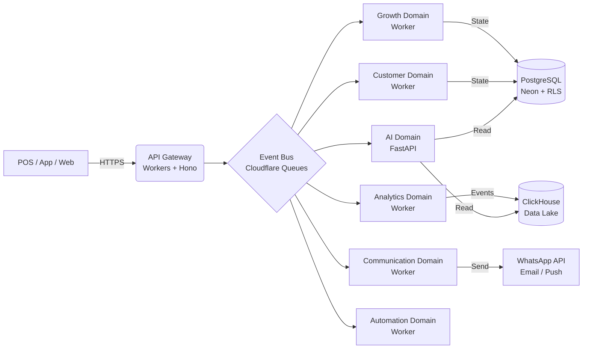

# 07-Architecture.md
**[DOCUMENTO]:** Vyloop Core Architecture | **[VERSIÓN]:** v2.0 | **[ESTADO]:** Draft | **[RESPONSABLE]:** Principal Software Architect

---

## 1. Filosofía: "The Event-First Core"

En un Growth OS, el estado es efímero, pero los eventos son eternos. Vyloop no consulta bases de datos para saber qué ocurrió — procesa el flujo de eventos para proyectar el estado actual.

**Dos consecuencias arquitectónicas inmediatas:**

1. **Decoupling total:** Los dominios nunca se llaman entre sí mediante acoplamiento directo. Publican eventos al bus y consumen únicamente lo que necesitan. Un fallo en Analytics no afecta el procesamiento de puntos.

2. **Paralelismo natural:** La carga de trabajo de un evento (`PurchaseCompleted`) se distribuye simultáneamente: el Growth Service calcula puntos, el AI Service reevalúa el score de churn, el Analytics Service inserta en ClickHouse, y el Automation Service evalúa workflows — todo en paralelo, sin bloqueo.

---

## 2. Capas de la arquitectura

### Capa A — Ingesta (The Gateway)

**API Gateway — Cloudflare Workers + Hono**
- Punto de entrada único para toda petición al sistema.
- Responsable de: AuthN/AuthZ (OAuth 2.0 + OIDC), rate limiting, routing a dominios, validación de headers de localización (`region`, `currency`, `timezone`).
- El header `X-Business-ID` es obligatorio en toda petición autenticada y se valida contra el token de acceso — primera línea de aislamiento multi-tenant.

**Event Ingestor**
- Endpoint de alta disponibilidad para ingesta de eventos desde POS, app nativa y webhooks externos.
- Valida el esquema del evento contra el Schema Registry (Cloudflare KV) antes de inyectarlo al bus.
- Si el esquema no es válido: rechaza el evento, registra el error, no llega al bus.

```
Petición entrante
      ↓
API Gateway (auth + rate limit + routing)
      ↓
¿Es un evento? ──→ Event Ingestor → Schema Registry → ¿válido?
                                                          ↓ sí
                                                      Bus de Eventos
                   ↓ no
              Error 400 + log
```

---

### Capa B — El Bus de Eventos (The Nervous System)

**Tecnología por fase:**

| Fase | Tecnología | Cuándo migrar |
|---|---|---|
| PMV y Fase 2 | Cloudflare Queues | Hasta ~1M eventos/día |
| Fase 3 — Enterprise | Apache Kafka / Confluent | Cuando se requiera multi-región real, replay histórico o throughput masivo |

**Garantía:** *At-least-once delivery*. Cada evento se persiste antes de ser procesado. Si un Worker consumidor falla, el evento se reintenta automáticamente. Los consumidores deben ser idempotentes — procesar el mismo evento dos veces no debe generar duplicados.

---

### Capa C — Servicios de Dominio (Bounded Contexts)

Cada dominio es un Cloudflare Worker aislado. No comparte memoria con otros Workers. Se comunica exclusivamente vía el bus de eventos.

**Excepción:** Los servicios de IA/ML que requieren Python (predicción de churn, Business Copilot, embeddings) se despliegan como contenedores FastAPI separados, accesibles únicamente como servicios internos — nunca expuestos directamente al API Gateway público.

---

### Capa D — Persistencia (The Memory)

**PostgreSQL (Neon) — Estado transaccional:**
- Almacena el estado actual de las entidades: Tenant, Branch, Customer, LoyaltyProgram, Tier, PointsTransaction.
- Multi-tenant via `business_id` con Row-Level Security — garantía de aislamiento a nivel de base de datos, no solo de aplicación.
- Preparado para sharding de `customer_events` por `business_id` cuando el volumen lo exija.

**ClickHouse Cloud — Analytics / Data Lake:**
- Destino de todos los eventos del bus. Append-only, nunca se actualiza.
- Optimizado para consultas analíticas: cohortes, retención, segmentación masiva, benchmarks cross-tenant.
- Se incorpora en Fase 2 cuando el volumen de negocios piloto genere datos suficientes para que las consultas analíticas aporten valor real.
- Los índices GIN sobre campos JSONB en PostgreSQL cubren las necesidades analíticas del PMV.

---

## 3. El ciclo de vida de un evento — ejemplo: compra completada

```
1. INGESTA
   POS / App / Web → POST /v1/events/{tipo}  (autenticado; {tipo} es una clave del registry)
   
2. VALIDACIÓN
   Event Ingestor → Schema Registry → ¿el body valida contra el esquema de {tipo}? → sí
   
3. PUBLICACIÓN AL BUS
   Cloudflare Queues recibe el evento con garantía at-least-once
   
4. BROADCAST PARALELO A SUSCRIPTORES
   ┌─ Growth Worker      → calcula puntos según tasa del programa y multiplicador de tier
   ├─ Customer Worker    → actualiza LastPurchaseDate y agrega evento al Customer360
   ├─ Analytics Worker   → inserta evento en ClickHouse (Fase 2+) o PostgreSQL event log (PMV)
   ├─ AI Worker          → reevalúa ChurnPrediction score del cliente
   └─ Automation Worker  → evalúa si algún workflow activo tiene este evento como trigger
   
5. EVENTOS SECUNDARIOS (publicados por los Workers anteriores)
   Growth → PointsAssigned → Communication Worker → notifica al cliente su nuevo saldo
   AI     → ChurnRiskDetected (si score supera umbral) → Communication + Dashboard alert
```

---

## 4. Localización en vuelo (Localization In-Flight)

Cada evento lleva metadatos de contexto en su payload:

```json
{
  "header": {
    "business_id": "uuid",
    "timestamp": "2026-06-30T12:00:00Z",
    "localization": {
      "country": "CL",
      "currency": "CLP",
      "timezone": "America/Santiago",
      "language": "es-CL"
    }
  },
  "payload": { ... }
}
```

Los Workers consumidores aplican la lógica local basada en estos metadatos. **Nunca hay bifurcaciones de código por país** — el comportamiento diferente entre Chile y Brasil es resultado de la configuración del tenant y los metadatos del evento, no de un `if country == "CL"`.

---

## 5. Escalabilidad global

| Dimensión | Estrategia |
|---|---|
| Multi-tenancy | `business_id` en todas las tablas + RLS en PostgreSQL. Aislamiento lógico sin costo operativo de esquemas separados. |
| Latencia global | Cloudflare Workers ejecutan en el PoP más cercano al usuario — sin configuración regional adicional. |
| Volumen de eventos | Cloudflare Queues escala automáticamente. Migración a Kafka cuando el throughput lo justifique. |
| Volumen analítico | ClickHouse escala horizontalmente. Sharding de `customer_events` por `business_id` cuando supere cientos de millones de filas. |
| Event-Sourcing | La capacidad de reconstruir el estado de cualquier cliente en cualquier momento re-procesando su historial de eventos — sin tocar datos de otros tenants. |

---

## 6. Diagrama de flujo completo



---

## 7. Documento anterior

Este documento reemplaza:
- `07-Architecture.md` v1.0 (Project Atlas)
- Sección de arquitectura general del `Vyloop SDD v1` (aprobado)

