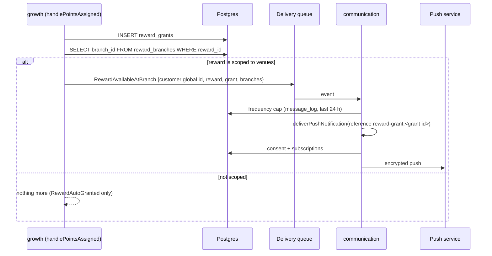

# Proposal: Branch Reward Trigger

> Status: scheduled — decisions answered 2026-10-20 (Unit 0 of `tasks.md`).
> Delivery: chained PRs, stacked-to-main.

## Intent

Tell a customer, by push, that a reward they earned can be redeemed at a
specific venue of the business.

This is the `RewardAvailableAtBranch` trigger listed in
`docs/19-Geolocalizacion-Notificaciones.md` §7.4 (line 304) and in the F3 phase
(line 398). It was deliberately left out of the proximity work
(`odd/tasks/proximidad-y-hardening.md`, Log L1, "Desviaciones", item 1) because
it needs a vertical the proximity gate does not cover: rewards have no venue.

## Why it was deferred

The PMV already tells a business's customers about a venue through campaigns
(`PushCampaignRequested`), and a customer already sees their rewards in the
customer web. This trigger adds a second, automatic message on top of that, and
it raises product questions (below) that are not needed to demonstrate the PMV.

## The current state, verified against the code

- **Rewards have no venue.** `rewards` (`packages/db/src/schema.ts:853-879`)
  carries the business, cost, stock, `auto_grant_threshold` and validity, and
  no branch.
- **The auto-grant path exists.** `handlePointsAssigned`
  (`workers/growth/src/event-handler.ts:196`) re-reads the balance, selects the
  rewards whose `auto_grant_threshold` is reached (lines 299-309), inserts a
  `reward_grants` row (lines 330-339) and publishes `RewardAutoGranted` to
  `DOMAIN_EVENTS_QUEUE` (line 355) through `buildRewardAutoGrantedEvent`
  (`workers/growth/src/helpers.ts:480`).
- **The growth worker can already publish deliveries.** It holds a
  `DELIVERY_QUEUE` producer binding (`workers/growth/wrangler.jsonc`), and the
  check-in route publishes `CustomerCheckedIn` there
  (`workers/growth/src/routes.ts:1838-1850`).
- **The delivery path exists.** The communication worker consumes
  `vyloop-notification-deliveries`, dispatches by `event.type`
  (`workers/communication/src/event-handler.ts:21-41`), and
  `deliverPushNotification` (`workers/communication/src/push-delivery.ts:130`)
  re-checks the `nearby_notifications` consent and delivers to every
  registered browser, deduplicating by `reference_id`.

## Scope

### In Scope

1. A `reward_branches` table: the venues at which a reward can be redeemed.
   A reward with no rows is redeemable everywhere (today's behaviour).
2. The reward API in the growth worker accepts and returns `branch_ids` on
   create, update and read.
3. The `RewardAvailableAtBranch` event constant and its JSON schema, registered
   at startup with the others.
4. A producer in the auto-grant path: when a reward that is scoped to one or
   more venues is granted, publish `RewardAvailableAtBranch` to the delivery
   queue.
5. A consumer in the communication worker that turns the event into a push
   delivery through `deliverPushNotification`, with a reference derived from
   the grant so a redelivered event never notifies twice.
6. The dashboard reward form lets the business choose the venues.

### Out of Scope

- **Redemption restricted to the venue.** Whether `POST /v1/loyalty/rewards/redeem`
  must refuse a redemption at another venue is a separate rule (open question
  Q4). This change only notifies.
- **Notifying when a reward is published to the catalog** (a broadcast to a
  venue's audience). That is a campaign, and the campaign path already exists.
- **WhatsApp or email.** Push only, through the existing transport.
- **Fixing the auto-grant race** (check-then-insert on `reward_grants`,
  `event-handler.ts:311-335`). Noted; the delivery reference prevents a double
  push even if the grant race produced two grants of the same reward.

## Product Decisions (answered 2026-10-20)

| #  | Decision |
| -- | -------- |
| Q1 | Only the customer the reward was granted to is notified. A broadcast to a venue's audience is a campaign. |
| Q2 | Reuse `nearby_notifications`. The consent copy shown in the customer web MUST mention rewards, not only proximity, or the permission is used for something it did not describe. |
| Q3 | At most one reward notification per customer per business per 24 h; further grants inside the window are acked without a delivery. |
| Q4 | Redemption is not restricted to the reward's venues in this change. |
| Q5 | The message MUST NOT name a single venue. It names the venue when the reward is scoped to exactly one, and otherwise states how many venues it is available at. Naming one venue while Q4 leaves redemption unrestricted would send the customer to a place where the reward may not be honoured. |
| Q6 | Quiet hours are not part of this change; they belong to the transport and apply to every push. |

## Capabilities

### New Capabilities

None.

### Modified Capabilities

- `growth-engine`: rewards can be scoped to venues; the auto-grant publishes
  `RewardAvailableAtBranch` for a scoped reward.
- `push-notifications` (canonical in `openspec/specs/push-notifications/spec.md`
  since `push-transport` was archived on 2026-10-20): the delivery of
  `RewardAvailableAtBranch`.
- `event-bus`: the `RewardAvailableAtBranch` event type.
- `schema-registry`: its schema.
- `database`: the `reward_branches` table.

## Approach

**A join table, not a column.** A business with three venues will scope a
reward to two of them; a nullable `rewards.branch_id` would force a choice of
one, and changing it later is a data migration. `reward_branches(reward_id,
branch_id, business_id)` with a primary key on `(reward_id, branch_id)` keeps
"no rows" meaning "every venue", so every existing reward keeps its meaning
without a backfill.

**The event travels on the delivery queue.** It is produced by growth and
consumed by communication. The domain events queue's single consumer is growth
itself; the delivery queue is the one communication consumes, and growth
already publishes `CustomerCheckedIn` there. The event is published after the
`reward_grants` insert, exactly where `RewardAutoGranted` is published today,
and only when the reward has at least one `reward_branches` row.

**The payload names the customer by global id.** `deliverPushNotification`
resolves the customer by `(global_id, business_id)`; the grant path holds the
internal id (`customer.id`), so the producer reads `customers.global_id`
alongside, as the check-in producer does.

**The delivery reuses the push path entirely.** The handler calls
`deliverPushNotification` with `reference_id = reward-grant:<reward_grants.id>`.
The consent is re-checked there; a customer without a browser or without the
consent is acked silently, as today. The frequency cap (Q3) is read from
`message_log`: a `sent` push row for this customer whose reference begins with
`reward-grant:` in the last 24 h skips the delivery.

**The message text** is built in the communication worker from the payload:
the reward name plus the venue name when the reward is scoped to exactly one
venue, and otherwise the number of venues. Spanish, with a URL to the customer
web's rewards view. No points balance and no customer data travel in the push
body. This follows Q5: with redemption unrestricted, a message naming one of
three venues is a wrong address.

## Risks

- **Product risk is the main risk.** An automatic message a customer did not
  expect is the fastest way to lose a push permission. Q1-Q3, and the consent
  copy Q2 requires, exist for that.
- **A new table read in a hot path.** `handlePointsAssigned` runs on every
  points assignment; the extra read happens only after a grant, which is rare.
- **Schema registration drift.** A new schema must be added to
  `packages/schema-registry/scripts/register-schemas.ts` and to its test mocks,
  or the deploy registers a set that does not include it.

## Rollback Plan

1. Revert the growth deploy: the producer stops; nothing else depends on it.
2. Revert the communication deploy: an event already queued falls into the
   `default` branch of `handleEvent`, which logs and acks it.
3. `reward_branches` can stay: an empty or ignored table changes no existing
   behaviour. Dropping it loses only the venue scoping the businesses entered.
