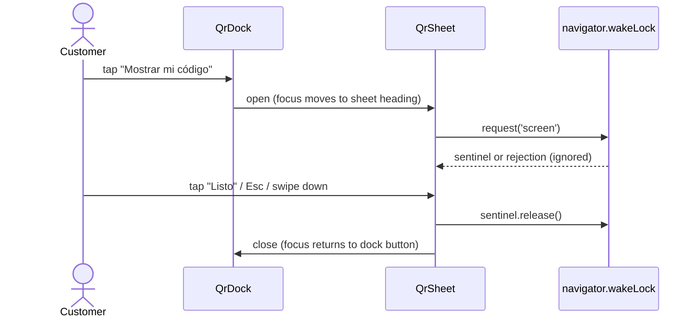

# Design: Customer Profile Redesign

Visual reference: `mockup.html` (open it in a browser). The middle phone is the
target screen, the right phone is the QR sheet.

## Page order

| # | Block | Component (new or reused) | Data source |
|---|-------|---------------------------|-------------|
| 0 | Top bar: club name, "Ayuda" | `ProfileTopBar` (new) | `business.name` |
| 1 | Identity card | `IdentityCard` (new, replaces `MemberPass` on this page) | `fullName`, `createdAt`, tier fields, `points`, `nextTier` |
| 2 | Next redemption card | `NextRedemptionCard` (new) | `nextReward` (Phase 3) |
| 3 | Recent purchases | `PurchaseTimeline` (new, replaces `Activity`) | `recent_transactions`, `customer_events` via `buildTimeline` |
| 4 | Wallet row | `WalletCard` (reused, compact variant) | `/v1/wallet/pass` |
| 5 | Your data | `PersonalData` (new) | `fullName`, `phone`, `email`, `birthDate` |
| 6 | Notifications | `ConsentList` (reused) | consents (enable-nearby-consent) |
| 7 | Account | logout, delete (hidden until Phase 5) | n/a |
| + | Fixed dock "Mostrar mi código" | `QrDock` + `QrSheet` (new) | `globalId`, member code from wallet |

`MemberPass` and `TierLadder` stay in the codebase. The full tier ladder moves
to `/profile/history`, which already shows the long-form figures.

## Tokens and type

Use the existing design-system tokens only (`packages/design-system/src/tokens`):
`--brand-*` amber, `--stone-*` neutrals, `--radius-xl`, Inter. No new colours.

- Identity card: `--surface-card`, radius 22px, one soft shadow. The only
  card with a shadow on the page.
- Next redemption card: `--brand-50` fill, `--brand-200` border, a dotted
  perforation line 64px from the right edge; the stub holds the price.
- Lists (data, notifications): bordered, no shadow.
- Balance figure: 26px / 800, tabular numbers. The only large number.
- Labels are sentence case. No all-caps, no eyebrows.

## Copy rules

- Unit: always `program.pointsCurrency`. Reward names are titles, never units.
- Dates: `es-CL`. Relative up to 6 days ("Ahora mismo", "Hace 5 min",
  "Hace 3 h", "Ayer", "Hace 4 días"), then short absolute ("28 sep"), adding
  the year when it is not the current year ("6 dic 2025").
- Money: `Intl.NumberFormat('es-CL', { style: 'currency', currency: 'CLP', maximumFractionDigits: 0 })` gives "$11.400".
- Voice matches the existing copy (voseo): "Podés", "Mostrale", "canjeás".

## Next reward rule (server-side)

Owned by the customer worker, next to `nextTier`, for the same reason: one
owner for the rule, the client only renders.

```
candidates = rewards where business_id = tenant
                       and deleted_at is null
                       and (valid_from is null or valid_from <= now)
                       and (valid_until is null or valid_until > now)
                       and (stock is null or stock > 0)
affordable = candidates where points_cost <= balance
nextReward = cheapest of candidates where points_cost > balance  (tie: name asc)
           , or null
```

Response shape:

```json
"nextReward": { "id": "…", "name": "Burger gratis", "pointsCost": 100, "pointsMissing": 70 } | null,
"affordableRewardsCount": 1,
"activeRewardsCount": 4
```

Card states, in priority order:

1. `affordableRewardsCount > 0`: "Ya podés canjear" + the cheapest affordable
   reward's name (send it as `affordableReward` with the same shape, `pointsMissing: 0`),
   button "Canjear" to `/profile/rewards/confirm?reward=<id>`.
2. `nextReward != null`: progress card.
3. Both empty: the card is not rendered.

## Purchase timeline row mapping

| Source row | Title | Second line | Right column |
|------------|-------|-------------|--------------|
| earn with `purchaseAmount` | "Compra de $11.400" | relative/absolute date | "+20 puntos" / "saldo 30" |
| earn without `purchaseAmount` (historical, visit program, manual) | `note` or "Puntos ganados" | date | same |
| redeem | "Canjeaste " + note or "un premio" | date | "−100 puntos" / "saldo 0" |
| `customer.registered` event | "Te uniste al club" | date | empty |

Direction is carried by `type`, magnitude by `Math.abs(points)` (see the
`Transaction` doc comment in `api.ts`). Text carries the direction; the sign
glyph is `aria-hidden`.

## QR sheet



- The sheet renders the existing `MemberQr` content at 210px minimum and the
  member code grouped in threes ("K7F 2QX").
- The member code comes from the wallet pass response. When it is absent, the
  sheet shows the QR only and the line "Tu código aparece cuando agregás la
  tarjeta a Wallet".
- `role="dialog"`, `aria-modal="true"`, focus trapped, Esc closes.

## Self-service edit

`PATCH /v1/customers/me` with `{ fullName?, email?, birthDate? }`.

- Identity comes from `X-User-Id` + `X-Business-Id` (gateway-injected from the
  customer JWT), exactly like `GET /v1/customers/me`. No id in the path.
- New customer-token scope `profile:write`, issued at login next to
  `rewards:read` and `rewards:redeem`, enforced by the gateway.
- Validation reuses the customer schema used by the merchant
  `PATCH /v1/customers/:id`. Unknown fields are rejected, `phone` included.
- Emits `customer.profile_updated` on `DOMAIN_EVENTS_QUEUE`.

## Account deletion (Phase 5)

Decided 2026-10-27. Deleting an account **anonymises the customer at once**;
there is no grace period and no recovery. Rows are kept and stripped of
personal data, never hard-deleted: a hard delete cascades through the
merchant's sales history, and `referrals` and `workflow_executions` reference
`customers.id` with no `ON DELETE` action, so it would fail anyway.

| Data | Outcome |
| --- | --- |
| `customers`: `full_name`, `phone`, `email`, `birth_date`, `identity_doc`, `identity_type`, `metadata`, `member_code` | Set to null; `deleted_at` set. A null phone frees `uq_customers_business_phone`, so the number can register again as a new customer. |
| `points_transactions`, `checkins`, `reward_grants`, `referrals` | Kept for the merchant's totals; free-text `note` and `items` cleared. |
| `customer_events.payload`, `message_log.content` and `metadata`, `consents.ip_address` | Cleared. |
| `push_subscriptions`, `churn_predictions` | Deleted. |
| Google Wallet pass | Expired through the Wallet API, so the name stops showing on the phone. |
| Points balance | Lost. The confirm step says so before the customer accepts. |
| Session | The web signs out. A token still alive (at most one hour) can neither read nor write: every customer route, read or write, resolves the customer with `deleted_at IS NULL` and answers 404 otherwise. Writes that reach the row by `customers.id` from elsewhere (check-ins, points, referrals) must refuse a deleted customer too; 5.2 verifies each one. |

The anonymisation runs in one database transaction. The wallet expiry runs
after it: a failure is logged and the pass stays marked as not expired, and a
scheduled sweep retries every pass of a deleted customer that is not expired
yet, so a transient Wallet API error does not leave the name on the phone.

Deleting a customer that is already deleted answers 204 and changes nothing
in the database; it only retries a pending wallet expiry. Two concurrent
deletes converge on the same anonymised row.

The merchant's `DELETE /v1/customers/:id` uses the same anonymisation, so
what `docs/08-API-Design.md` promises is true for both.

Open, outside this change: confirm against Ley 21.719 with legal counsel.

## Decisions

| Decision | Rationale |
|----------|-----------|
| `nextReward` server-side | Same rule as `nextTier`: one owner. The client choosing from a paginated catalog could pick a different reward than the dashboard. |
| Store `purchase_amount` instead of reading it from events | Events are capped and typed loosely (`payload`), transactions are the ledger the history page already paginates. |
| No backfill | Old amounts were never stored; inventing them from points × unit would show numbers the customer never paid. |
| QR in a sheet, not inline | At the counter speed matters; the dock is reachable from any scroll position. |
| Keep `MemberPass` | It is covered by tests and still useful for the history page; deleting it is not needed for this change. |
