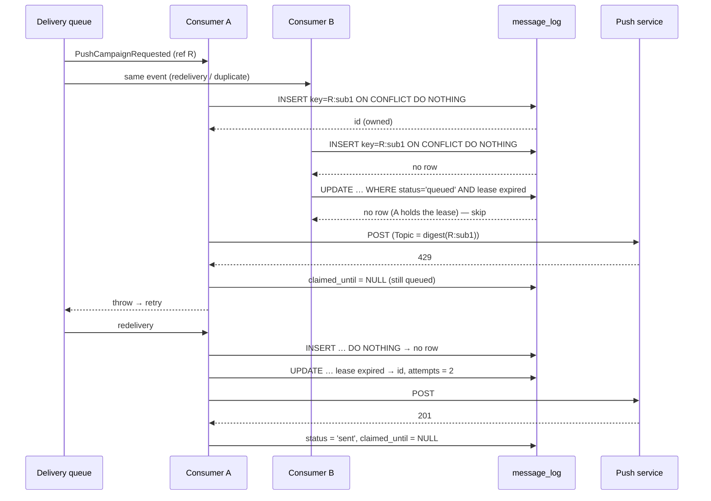

# Proposal: Campaign Delivery Idempotency

> Status: deferred — post-PMV. Documented 2026-10-20; not scheduled.

## Intent

Make "one campaign reaches one browser at most once" a property the database
enforces, instead of a property that holds only while nothing runs concurrently.

Today the guarantee is a read followed by a write. It is correct for one
consumer processing one event at a time, which is what the PMV runs. It is not
correct for two consumers delivering the same event at the same moment, or for
two operators composing the same campaign at the same moment. Neither happens
often at PMV volume, which is why this is deferred; both become likely as soon
as a campaign is large enough for the queue to spread its retries.

## The current behaviour, verified against the code

**Delivery dedupe is check-then-send.** `deliverPushNotification`
(`workers/communication/src/push-delivery.ts:130`) builds a delivery reference
per browser, `<campaign reference>:<subscription id>` (`push-delivery.ts:206`),
then:

1. reads `message_log` for a row with that `content->>'reference_id'`,
   `channel = 'push'` and `status IN ('sent', 'failed')`
   (`push-delivery.ts:216-230`); if one exists the browser is skipped;
2. inserts a new `queued` row (`push-delivery.ts:234-250`);
3. encrypts, signs and sends, then updates the row to `sent` or `failed`.

Two consumers that read before either has written both pass step 1 and both
send. Nothing in `message_log` (`packages/db/src/schema.ts:802`) prevents it:
there is no unique constraint on the reference.

**A plain unique index would break the retry path.** A `429` from the push
service throws (`push-delivery.ts:325-331`) so the queue redelivers the whole
event (`workers/communication/wrangler.jsonc`, consumer `max_retries: 3`). The
redelivery reaches step 2 again and inserts **another** `queued` row with the
same reference. Every retried delivery already has one row per attempt. A
unique index on the reference would turn the second attempt into a constraint
violation, which throws, which is retried, which violates again — the retry
would never send.

**The campaign route's duplicate probe is also check-then-act.**
`POST /v1/communication/push/campaigns`
(`workers/communication/src/campaign-routes.ts:263-285`) refuses a campaign
whose reference already prefixes a `message_log` row
(`starts_with(content->>'reference_id', '<ref>:')`). Rows only exist after the
consumer has delivered, so two POSTs with the same `reference_id` within the
queue latency both get `202`, and both campaigns are published.

**The dashboard counts attempts, not deliveries.**
`workers/communication/src/delivery-stats.ts:97-108` groups `message_log` by
status. Every abandoned attempt row of a retried delivery stays `queued`
forever, so `queued` is inflated by retries and by deliveries whose retries were
exhausted (the consumer has no dead-letter queue).

## Scope

### In Scope

1. A `delivery_key` column and a `claimed_until` column on `message_log`, and a
   partial unique index `uq_message_log_delivery_key` on
   `(business_id, delivery_key) WHERE delivery_key IS NOT NULL`.
2. A claim-then-send delivery in `deliverPushNotification`: exactly one row per
   delivery key, created with `INSERT … ON CONFLICT DO NOTHING`, reclaimed on a
   retry only when it is still `queued` and its lease has expired, with the
   attempt count kept in `metadata.attempts`.
3. Releasing the lease on a `429` before throwing, so the queue's retry can
   reclaim the same row instead of creating another one.
4. A `push_campaigns` table keyed by `(business_id, reference_id)`, written by
   the campaign route with `INSERT … ON CONFLICT DO NOTHING`, which replaces the
   `message_log` prefix probe as the duplicate gate.
5. The migration that adds both, hand-applied and registered in
   `packages/db/drizzle/meta/_applied-outside-drizzle.json` with the evidence the
   drift gate derives.
6. The deliveries dashboard reading one row per delivery, and the documentation
   of what `queued` now means.
7. The `Topic` header (RFC 8030 §5.4) on every push request, derived from the
   delivery key, so a duplicate that still slips through (see Risks) is
   collapsed by the push service while undelivered.

### Out of Scope

- **Exactly-once to the browser.** A consumer that sends and dies before
  recording the outcome leaves a lease that expires; the retry sends again. The
  push service has no idempotency key. This change narrows the window to that
  crash; it cannot close it.
- **A dead-letter queue and a sweep that marks exhausted deliveries `failed`.**
  Useful, and independent of the claim model. Noted as a follow-up.
- **WhatsApp.** `handleWhatsAppOutboundRequested` already reads its row by an
  idempotency key written by the producer; its own race is a separate change.
- **The auto-reward grant race** (`workers/growth/src/event-handler.ts:311-335`,
  check-then-insert on `reward_grants`). Same pattern, different table.
- **A campaigns UI.** The table is a gate and a record, not a product surface.

## Capabilities

### New Capabilities

None.

### Modified Capabilities

- `push-notifications` (defined by `openspec/changes/push-transport`, not yet
  archived into `openspec/specs/`): a delivery is claimed before it is sent; a
  campaign reference is claimed when it is composed. **Blocked by:** this change
  MUST NOT be archived before `push-transport` is archived or its spec is
  otherwise accepted; the delta is written against it.
- `database`: the `message_log` delivery key and lease, and the
  `push_campaigns` table.

## Approach

### Decision: a claimed row per delivery key, not an advisory lock

| Option                                               | Verdict  | Why                                                                                                                                                                                                                                                                                                                        |
| ---------------------------------------------------- | -------- | -------------------------------------------------------------------------------------------------------------------------------------------------------------------------------------------------------------------------------------------------------------------------------------------------------------------------- |
| Unique index on `content->>'reference_id'` as-is     | Rejected | Breaks retries (one row per attempt today), and the reference is the bare subscription id when the producer gave none (`push-delivery.ts:206-208`), so two unrelated unreferenced messages to one browser would collide.                                                                                                     |
| `pg_advisory_xact_lock(hashtext(key))` around the send | Rejected | The lock lives in a transaction, and the transaction would have to stay open across an HTTP call to a third party. `createDb` (`packages/db/src/index.ts:6`) hands out a `Pool`; holding a pooled connection for the length of a push request multiplies connection usage by the batch size. The lock also leaves no record: after it is released, a late duplicate has nothing to read. |
| **Claimed row with a lease (chosen)**                | Chosen   | The row is the lock **and** the record. The unique index makes the claim atomic without a transaction, retries reuse the same row, and the outcome a later duplicate reads is the same row the first one wrote.                                                                                                             |

### Decision: a dedicated `delivery_key` column, not an expression index

`delivery_key` is written **only when the producer gave a reference**, so the
index is partial on `delivery_key IS NOT NULL` and unreferenced messages are
never deduplicated (today's behaviour). A plain column also keeps the index
name the evidence the drift gate checks (`scripts/check-migration-drift.mjs:250`
reads `CREATE [UNIQUE] INDEX "<name>"`), and lets the legacy rows keep a `NULL`
key, so the index can be created on a table that already holds duplicate
references without deduplicating history first. `content->>'reference_id'` is
still written for continuity.

### The claim

```text
claim(key):
  INSERT INTO message_log (…, status, delivery_key, claimed_until, metadata)
  VALUES (…, 'queued', key, now() + LEASE, '{"attempts":1}')
  ON CONFLICT (business_id, delivery_key) WHERE delivery_key IS NOT NULL
  DO NOTHING
  RETURNING id                                   -- a row: this consumer owns it

  -- no row: someone created it before. Reclaim only an abandoned attempt.
  UPDATE message_log
     SET claimed_until = now() + LEASE,
         metadata = jsonb_set(metadata, '{attempts}',
                     to_jsonb(coalesce((metadata->>'attempts')::int, 0) + 1))
   WHERE business_id = $b AND delivery_key = key
     AND status = 'queued'
     AND (claimed_until IS NULL OR claimed_until < now())
  RETURNING id                                   -- a row: this consumer owns it
                                                 -- none: decided, or held — skip
```

`LEASE` is a constant (proposed 60 s) longer than the bounded push request.
Outcomes clear the lease: `sent` and `failed` set `claimed_until = NULL` with
the status; a `429` sets `claimed_until = NULL` and leaves `queued` before the
throw, so the queue's redelivery reclaims immediately.



### The campaign reference

```text
POST /v1/communication/push/campaigns
  INSERT INTO push_campaigns (business_id, reference_id, title, body, url, target, status)
  VALUES (…, 'requested')
  ON CONFLICT (business_id, reference_id) DO NOTHING
  RETURNING id
  no row → 409 DUPLICATE_MESSAGE (unchanged code and message)
  row    → publish PushCampaignRequested → 202
           publish throws → DELETE the row, then rethrow (the reference is free again)
```

The `message_log` prefix probe stays for one release as a second check, so a
reference used by a campaign composed **before** the table existed is still
refused; it is removed by a follow-up once that window is past.

`push_campaigns` is added to `BUSINESS_ID_TABLES`
(`packages/db/src/rls.ts:25`) so it receives the tenant policy in the RLS
rollout, like `push_subscriptions` did.

### What the dashboard counts after the change

One row per referenced delivery, not one per attempt. `queued` then means
"claimed and not decided", which is either in flight or abandoned after the
retries were exhausted. `delivery-stats.ts` keeps its three counts; its doc
comment and `docs/` must say that a `queued` row older than the lease plus the
queue's retry horizon is an exhausted delivery. Legacy rows (`delivery_key IS
NULL`) are counted as before; historical `queued` attempts are not rewritten.

## Risks

- **Migration on a hot table.** `message_log` is written on every delivery.
  `ADD COLUMN` without a default is metadata-only; the index must be created
  `CONCURRENTLY` (which is outside a transaction, so the migration is split
  into two statements applied by hand). Drift-gate evidence: the two columns and
  the index name.
- **Lease too short.** A push request slower than `LEASE` lets a second
  consumer reclaim and send in parallel. The push `fetch` in `attemptDelivery`
  (`push-delivery.ts:97`) has no timeout today; it must gain one
  (`AbortSignal.timeout`) shorter than the lease, and a test pins the relation
  between the two constants. A thrown network error releases the lease before it
  propagates, exactly like a `429`.
- **Send succeeded, outcome lost.** A crash between the `201` and the `UPDATE`
  leaves a `queued` row whose lease expires and is resent. Mitigated, not
  removed, by the `Topic` header.
- **The prefix probe and the table disagree during the transition.** The probe
  is the stricter of the two, so a disagreement only refuses, never sends twice.

## Rollback Plan

The code and the schema roll back separately.

1. **Code:** revert the worker deploy. The previous `deliverPushNotification`
   ignores `delivery_key` and `claimed_until` (nullable, no default), and the
   previous campaign route ignores `push_campaigns`. Both keep working.
2. **Schema:** only if required, `DROP INDEX CONCURRENTLY uq_message_log_delivery_key`,
   then drop the two columns and `push_campaigns`, and remove the entry from
   `_applied-outside-drizzle.json`. Dropping `push_campaigns` loses the campaign
   records written since the deploy; `message_log` keeps every delivery.
