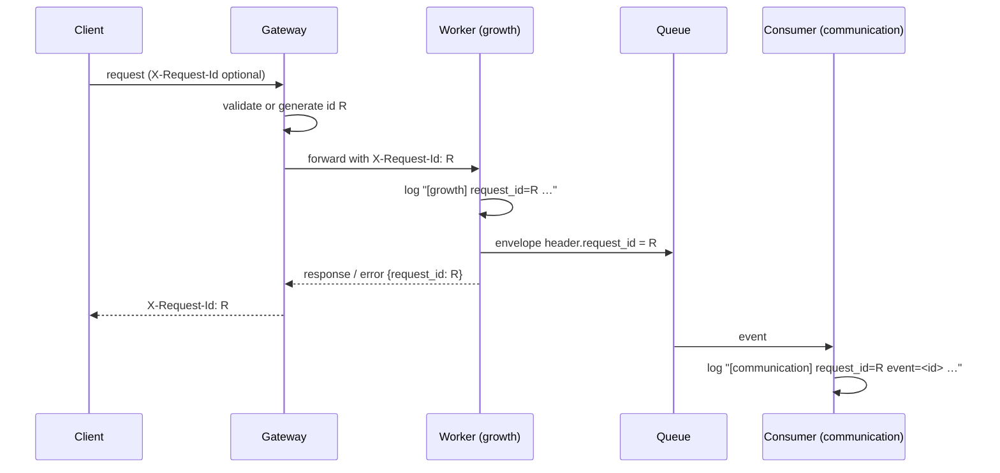

# Proposal: Request Tracing

> Status: deferred — post-PMV. Documented 2026-10-20; not scheduled.

## Intent

When a user reports an error with a `request_id`, find every log line that
request produced: in the gateway, in the worker that handled it, and in the
queue handlers that ran because of it.

Today that is possible only for errors that are born **in the gateway**. The
backlog records the gap (`docs/14-Backlog.md:311-317`, "El hueco de
`request_id` en todos los workers"): the id is cut at the gateway/worker
boundary.

## The current state, verified against the code

- **The gateway generates an id per error, not per request.** Its `onError`
  (`apps/gateway/src/index.ts:482-521`) generates one UUID and uses it for both
  the response body and the log line — the pattern to keep. But `notFound`
  (`index.ts:428-438`) and the router's three error responses
  (`apps/gateway/src/router.ts:201, 225, 244`) each call
  `crypto.randomUUID()` for a body nobody logs, and the router's
  `console.error` (`router.ts:238`) logs no id at all.
- **Nothing is forwarded.** The router forwards `c.req.raw` unchanged
  (`router.ts:234-235`). The only headers the gateway injects are
  `X-User-Id`, `X-Business-Id` and `X-User-Role`
  (`apps/gateway/src/middleware/auth-inject.ts:30-40`), and the workers read
  only those (`extractAuthHeaders` in `workers/{automation,communication,customer,growth,wallet}/src/helpers.ts`).
  There is no `X-Request-Id` or `traceparent` anywhere in `apps/gateway/src`.
- **Worker error handlers log a bare error.** Seven workers have an
  `app.onError` that logs without an id and answers without one:
  `analytics` (`index.ts:216`), `automation` (`:59`), `communication` (`:67`),
  `customer` (`:66`), `growth` (`:109`), `identity` (`:1279`) and `wallet`
  (`:172`). `compliance` has none. Their error envelopes are
  `{ error: { code, message } }`, which does not meet the `api-gateway` Error
  Format requirement (`{ code, message, request_id }`).
- **Events lose it too.** `createEnvelope`
  (`packages/event-bus/src/index.ts:130`) builds `{ id, type, source, …,
  header, payload }` with no request id, and `consume` (`:103-120`) logs a
  failed event by its event id only. The envelope header schema
  (`packages/schema-registry/src/index.ts:184-209`) has
  `additionalProperties: false`, so a header field cannot be added without
  changing the schema.

## Scope

### In Scope

1. One request id per inbound request, established by the gateway as its first
   middleware: the client's `X-Request-Id` when it is well-formed, otherwise a
   new UUID.
2. The id forwarded to every worker in `X-Request-Id`, and echoed in the
   `X-Request-Id` response header of every gateway response.
3. Every gateway error body (`onError`, `notFound`, router errors, ingestor
   errors, support) uses **that** id instead of a fresh `crypto.randomUUID()`.
4. A small shared package, `@vyloop/request-context`: the header name, the
   validator, a Hono middleware that reads or generates the id, and a log
   prefix helper.
5. Every worker's `onError` logs `request_id=<id>` and answers with the
   `api-gateway` error format, including `request_id`. `compliance` gains one.
6. Event envelopes carry an optional `header.request_id`; `createEnvelope`
   accepts it; producers pass the current request's id; the envelope header
   schema allows it; `consume` logs it.
7. Service-to-service calls (automation → communication `scheduled`, growth →
   wallet RPC) pass the id when there is one.
8. Documentation: how to trace a request with `wrangler tail --search`.

### Out of Scope

- **Distributed tracing** (W3C `traceparent`, spans, OpenTelemetry export,
  Workers Trace Events / Logpush). The id is a correlation key, not a trace.
  The `X-Request-Id` choice does not prevent adding `traceparent` later.
- **Structured (JSON) logging** across the codebase. Only the prefix is
  standardised.
- **Log retention or a log backend.** Workers Logs / `wrangler tail` remain the
  tools.
- **Rewriting every log line in every handler.** Error paths, queue failures and
  the existing gateway log lines are in scope; informational `console.log`
  lines adopt the prefix opportunistically.

## Capabilities

### New Capabilities

- `request-tracing`: the request id's lifecycle in the workers and in queue
  handlers, and what may and may not be logged with it.

### Modified Capabilities

- `api-gateway`: the gateway establishes, forwards and echoes the id; every
  error body carries the request's own id.
- `event-bus`: the envelope header carries an optional `request_id`, and
  `consume` logs it.
- `schema-registry`: the shared envelope header schema allows `request_id`.

## Approach

**Header: `X-Request-Id`.** It is the de-facto header for a correlation id, it
is what an operator will search for, and it is independent of a tracing
standard the platform does not run.

**Accept a client id only when it is harmless.** A client-supplied id is useful
(a front end can log the id it sent) and dangerous (it lands in logs). The
gateway accepts it only if it matches `^[A-Za-z0-9._-]{8,128}$`; otherwise it
replaces it with a UUID. Workers apply the same validator to the header they
receive, and generate a UUID when it is absent (a call that did not come
through the gateway). A client cannot inject newlines, spaces or another
`key=value` pair into a log line.

**One id per request, held in the Hono context.** The middleware sets
`c.set('requestId', id)`, rewrites the forwarded request's `X-Request-Id`
(the same `new Request(req, { headers })` technique `auth-inject.ts` uses), and
sets the response header after `next()`. Every error body reads
`c.get('requestId')`.

**Log prefix, not log format.** `[<service>] request_id=<id>` followed by the
existing message. This is what `onError` in the gateway already writes
(`index.ts:518`), so one `wrangler tail --search <id>` finds both sides.

**Events.** `createEnvelope(type, header, payload)` keeps its signature;
producers pass `{ …header, request_id }`. Inside a queue handler there is no
HTTP request: `consume` reads `msg.body.header.request_id` and includes it in
its failure log, and handlers that log use the same prefix. An event a cron
produced has no request id, and the field is omitted rather than invented.

**Secrets stay out.** The id is the only thing added to log lines. The rule
already written in the gateway's `onError` (`index.ts:503-513`: no headers, no
cookies, no body) is made a requirement for every worker's error handler.

## Risks

- **Error body shape change.** Worker error bodies gain `request_id`. Additive;
  front ends that read `error.code` and `error.message` are unaffected. It is a
  contract change only in that it now meets the documented format.
- **Schema change in a shared header.** Adding an optional property to
  `envelopeHeaderSchema` affects every registered event schema at once. It is
  backward compatible (old events validate), but the registry is rewritten at
  deploy, and a producer deployed before the registry would be rejected by the
  ingestor's validation. Deploy order: schema registry first (already the
  first step of the deploy), then the workers.
- **Header forgery.** Mitigated by the validator; the id is never used for
  authorization.

## Rollback Plan

Every part is additive. Revert the deploys in reverse order (workers, gateway);
the `request_id` field in envelopes already queued is ignored by the previous
code. The schema change can stay: an optional property validates the old
envelopes as before.
